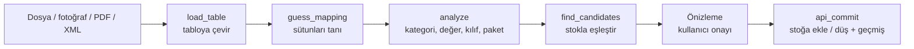

# Komponent Stok

Evdeki elektronik komponent stoğunu takip eden, tamamen yerel çalışan bir macOS uygulaması.

Sipariş faturalarını (CSV, Excel, PDF, fotoğraf, e-fatura XML) okuyup parçaları kategorilerine göre stoğa
ekler. KiCad / Altium / EasyEDA BOM'larını stokla karşılaştırıp neyin elde olduğunu, neyin eksik olduğunu
gösterir ve proje yapılınca kullanılan parçaları stoktan düşer. İnternet bağlantısı veya hesap gerekmez,
veriler bilgisayarda tek bir SQLite dosyasında durur.

---

## İçindekiler

- [Özellikler](#özellikler)
- [Kurulum ve çalıştırma](#kurulum-ve-çalıştırma)
- [Kullanım](#kullanım)
- [Desteklenen dosya türleri](#desteklenen-dosya-türleri)
- [Nasıl çalışıyor?](#nasıl-çalışıyor)
- [Proje yapısı](#proje-yapısı)
- [Geliştirme](#geliştirme)
- [Sınırlamalar](#sınırlamalar)

---

## Özellikler

- **Siparişten stoğa giriş:** LCSC, Mouser, DigiKey, Robotistan, direnc.net vb. sipariş dökümlerini okur.
  Sütunlar (MPN, tedarikçi kodu, adet, açıklama…) otomatik algılanır.
- **Fatura fotoğrafı ve PDF okuma:** Paketten çıkan kağıt faturanın fotoğrafı, sipariş sayfasının ekran
  görüntüsü ya da PDF e-arşiv faturası macOS'un yerleşik metin tanımasıyla (Apple Vision) okunur.
  Hiçbir şey internete gönderilmez.
- **E-fatura / e-arşiv XML (UBL-TR):** GİB standardındaki XML dosyasından ürün satırları doğrudan, tahmin
  yapmadan alınır.
- **Otomatik kategori:** Parçalar açıklamalarındaki Türkçe/İngilizce anahtar kelimelere ve BOM referans
  harflerine (R, C, U, Q…) göre 20 kategoriye ayrılır.
- **Akıllı BOM eşleştirme:** Direnç ve kondansatörlerde footprint adı birebir aranmaz; değer, montaj tipi
  (THT/SMD), kondansatör türü (elektrolitik/tantal/film/seramik), potansiyometre ayrımı ve voltaj
  karşılaştırılır. Yakın değerler ve farklı türler "alternatif" olarak önerilir.
- **Eksik listesi:** BOM'u kaç adet yapacağınızı girersiniz; yeterli / eksik / stokta yok durumu ve
  sipariş edilecekler listesi (CSV) çıkar.
- **Elle giriş ve düşme**, uyarı eşiği (azalan parçalar), konum ve not alanları, arama.
- **Geçmiş ve geri alma:** Her sipariş, proje ve elle değişiklik kaydedilir; tek tıkla geri alınabilir.
- **Paket hesabı:** "Kondansatör Paketi - 10 Adet" gibi ürünler paket sayısı × içerik olarak stoğa girer.

## Kurulum ve çalıştırma

**Gereksinimler:** macOS 11.3 veya üzeri, Python 3 (python.org veya Homebrew sürümü ya da sistemdeki
`/usr/bin/python3`), uygulamayı derlemek için Xcode Command Line Tools (`xcode-select --install`).
Ek Python paketi gerekmez; yalnızca standart kütüphane kullanılır.

```bash
git clone https://github.com/emrebuyukonder/komponent-stok.git
cd komponent-stok
./uygulamayi_derle.sh
```

Derleme `Komponent Stok.app` uygulamasını ve fotoğraf/PDF okuma aracı `bin/ocr`'ı üretir. Uygulamayı
çift tıklayarak açın; isterseniz Uygulamalar klasörüne veya Dock'a sürükleyin.

**Uygulama olmadan (tarayıcıda):**

```bash
python3 stok.py
```

`http://127.0.0.1:8765` tarayıcıda açılır. `BASLAT.command` dosyasına çift tıklamak da aynı şeyi yapar.

**Veriler nerede?** Uygulama veritabanını `~/Documents/Komponent Stok/stok.db` dosyasında tutar
(terminal sürümü `stok.py`'nin bulunduğu klasörde). Yedek almak için bu dosyayı kopyalamanız yeterlidir.
Farklı bir veritabanı için `STOK_DB=/yol/deneme.db python3 stok.py` kullanılabilir.

## Kullanım

| Sekme | Ne yapılır |
|---|---|
| **Stok** | Kategorilere ayrılmış parça listesi, arama, −/+ ile elle düşme/ekleme, düzenleme. *Azalanlar* ve *Tükenenler* filtreleri. CSV dışa aktarma. |
| **Sipariş girişi** | Sipariş dosyasını / fotoğrafını / PDF'ini bırakın (birden çok dosya aynı anda seçilebilir). Önizlemede kategori, değer, adet ve eşleşmeyi kontrol edip "Stoğa ekle"ye basın. |
| **Proje / BOM** | BOM dosyasını yükleyin ve kaç adet yapacağınızı girin. Eksikleri görün, listeyi indirin, onaylarsanız stoktan düşün. |
| **Geçmiş** | Tüm işlemler ve projelerin eksik listeleri; her işlem geri alınabilir. |

Kargo satırları ve BOM'daki DNP (takılmayacak) parçalar otomatik atlanır. Emin olunamayan eşleşmeler
"kontrol edin" uyarısıyla gösterilir ve açılır listeden değiştirilebilir.

## Desteklenen dosya türleri

| Tür | Örnek kaynak | Nasıl okunur |
|---|---|---|
| CSV / TSV / yapıştırılan tablo | LCSC, Mouser, DigiKey, KiCad BOM | Ayraç ve başlık satırı otomatik bulunur |
| Excel `.xlsx` | Sipariş dökümleri, Altium BOM | Standart kütüphaneyle (zip + XML) okunur |
| HTML tablo | Bazı sitelerin ".xls" diye verdiği HTML dosyaları | Tablo ayrıştırıcı |
| UBL-TR XML / `.zip` | E-fatura, e-arşiv, e-irsaliye | Ürün satırları doğrudan okunur |
| PDF | E-arşiv fatura | Sayfalar görüntüye çevrilip metin tanıma |
| Fotoğraf (JPG/PNG/HEIC) | Kağıt fatura, sipariş sayfası ekran görüntüsü | Apple Vision metin tanıma |

Eski `.xls` (ikili Excel) desteklenmez; `.xlsx` veya `.csv` olarak kaydedin. [`ornekler/`](ornekler)
klasöründe denemek için bir LCSC siparişi ve bir KiCad BOM'u bulunur.

## Nasıl çalışıyor?



**1. Tabloya çevirme ([`load_table`](stok.py)).** Dosyanın ilk baytlarına bakılarak türü anlaşılır.
Her tür sonunda aynı biçime, satır listesine dönüşür; böylece geri kalan adımlar kaynaktan bağımsızdır.

**2. Fotoğraf ve PDF okuma ([`invoice_rows`](stok.py), [`macos/ocr.swift`](macos/ocr.swift)).**
Apple Vision her metin parçasını konumuyla birlikte döndürür. "5 Adet" gibi adet hücreleri satır
*çapası* olarak alınır ve her çapaya, aynı hizadaki soldaki metin ürün adı olarak bağlanır. Fotoğraftaki
eğiklik, çapalarla açıklamalar arasındaki eğimlerin medyanıyla düzeltilir. Ürün adının adetin üstünde
olduğu web sitesi listelerinde ise "üstteki satır" düzeni kullanılır ([`stacked_rows`](stok.py)).

**3. Sütun tanıma ([`guess_mapping`](stok.py)).** Başlıklar Türkçe ve İngilizce eş anlamlı listesiyle
eşleştirilir (ör. `Mfr. #`, `Manufacture Part Number` → MPN). Önce birebir eşleşme, sonra "içerir"
eşleşmesi denenir; yanlış algılanan sütun arayüzden düzeltilebilir.

**4. Değer normalizasyonu ([`normalize_value`](stok.py)).** `4k7`, `4.7K`, `4K7 Ohm`, `4,7kΩ` → `4.7kΩ`;
`0.1uF`, `100n`, `100nF` → `100nF`. Böylece farklı yazımlar karşılaştırılabilir.

**5. Eşleştirme ([`find_candidates`](stok.py)).** Her satır stoktaki parçalarla puanlanır:

| Puan | Ölçüt |
|---|---|
| 100 | MPN aynı |
| 95 | Tedarikçi ürün kodu aynı |
| 85 | BOM değeri = stoktaki MPN (ör. `AO3400A`) |
| 75 | MPN başı aynı (`TL072` ↔ `TL072CP`) veya joker uyumu (`STM32F103C8Tx`) |
| 85–90 | Pasif: değer + montaj tipi (+ kondansatör türü) aynı |
| 65 | Pasif: değer aynı, montaj/tür bilgisi eksik |
| 40 / 25 | Alternatif: tür farklı (film ↔ seramik) / yakın standart değer (250p ↔ 220p) |

55 ve üzeri puanlar otomatik seçilir, altındakiler yalnızca öneri olarak listelenir. Elektrolitik ↔
seramik, THT ↔ SMD ve sabit direnç ↔ potansiyometre hiçbir zaman eşleştirilmez.

## Proje yapısı

```
komponent-stok/
├── stok.py                 # Sunucu ve tüm iş mantığı (Python, yalnızca standart kütüphane)
├── web/
│   ├── index.html          # Arayüz iskeleti
│   ├── app.js              # Arayüz mantığı (saf JavaScript, kütüphane yok)
│   └── style.css           # Açık/koyu tema stilleri
├── macos/
│   ├── main.swift          # Mac uygulama kabuğu: pencere (WKWebView), arka planda stok.py
│   ├── ocr.swift           # Fotoğraf/PDF metin tanıma aracı (Apple Vision)
│   └── icon.swift          # Uygulama simgesini çizer
├── uygulamayi_derle.sh     # .app paketini ve bin/ocr'ı derler
├── BASLAT.command          # Tarayıcı sürümünü başlatır
├── ornekler/               # Örnek LCSC siparişi ve KiCad BOM'u
└── direnc_kiti_600.csv     # Örnek: 30 değerli 600'lük direnç kiti
```

**Mimari:** `stok.py` `127.0.0.1` üzerinde küçük bir HTTP sunucusu açar ve hem arayüz dosyalarını hem de
JSON API'yi sunar. Mac uygulaması bu sunucuyu arka planda başlatıp arayüzü kendi penceresinde gösterir;
kapanınca sunucuyu da kapatır. Veritabanında üç tablo vardır: `components` (parçalar), `batches`
(sipariş/proje/elle işlem kayıtları) ve `transactions` (her işlemin parça bazında adet değişimleri;
geri alma bunları ters çevirir).

## Geliştirme

`stok.py` veya `web/` içinde değişiklik yaptıktan sonra tarayıcı sürümünü yeniden başlatmak yeterlidir.
Mac uygulamasının da güncellenmesi için `./uygulamayi_derle.sh` çalıştırılır.

Kendi verinize dokunmadan denemek için:

```bash
STOK_DB=/tmp/deneme.db python3 stok.py
```

**API uç noktaları:**

| Yöntem | Yol | Açıklama |
|---|---|---|
| `GET` | `/api/components` | Tüm parçalar ve kategoriler |
| `POST` | `/api/components` | Yeni parça |
| `PUT` / `DELETE` | `/api/components/<id>` | Parçayı güncelle / sil |
| `POST` | `/api/components/<id>/adjust` | Adet ekle/düş (`{"delta": -3, "note": "..."}`) |
| `POST` | `/api/import/preview` | Dosyayı oku, eşleştirmeleri döndür (stoğa yazmaz) |
| `POST` | `/api/import/commit` | Önizlemeyi onayla: sipariş → ekle, BOM → düş |
| `GET` | `/api/batches` | İşlem geçmişi |
| `POST` | `/api/batches/<id>/undo` | İşlemi geri al |
| `GET` | `/api/export.csv` | Stok listesini CSV indir |

## Sınırlamalar

- Fotoğraf ve PDF okuma yalnızca macOS'ta çalışır (Apple Vision). CSV/Excel/XML okuma ve arayüz,
  Python 3 olan her sistemde `python3 stok.py` ile çalışır.
- Metin tanıma sonuçları her zaman kontrol edilmelidir; önizleme bu yüzden vardır ve her işlem geri alınabilir.
- Uygulama tek kullanıcılıdır ve yalnızca `127.0.0.1`'den erişilebilir; ağdaki başka cihazlardan açılamaz.
- Python 3 gerektirir; uygulama paketinin içine Python gömülü değildir.
